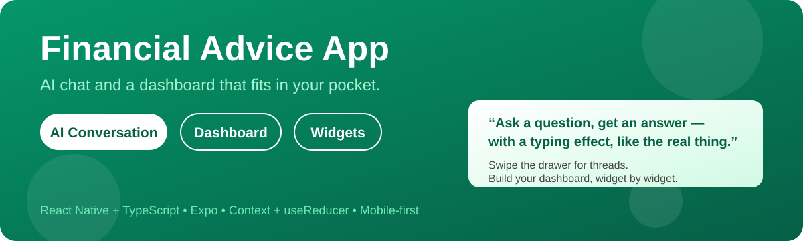
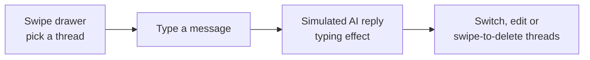

<p align="center">
  
</p>

<p align="center">
  <a href="https://github.com/smabdulmueid97/Financial-Advice-Mobile-Application"></a>
  <a href="https://github.com/smabdulmueid97/Financial-Advice-Mobile-Application"></a>
  <a href="https://github.com/smabdulmueid97/Financial-Advice-Mobile-Application"></a>
  <a href="https://github.com/smabdulmueid97/Financial-Advice-Mobile-Application/stargazers"></a>
</p>

<h1 align="center">Financial-Advice-Mobile-Application</h1>

<p align="center">
  A React Native + TypeScript app built for the <b>Lattice Mobile Developer Assessment</b>: an <b>AI Conversation</b> page and a <b>Dashboard</b> page with widget management — mobile-first throughout.
</p>

<p align="center">
  <a href="#-ai-conversation-page">AI chat</a> •
  <a href="#-dashboard-page">Dashboard</a> •
  <a href="#-uiux-decisions">UI/UX</a> •
  <a href="#-architecture">Architecture</a> •
  <a href="#-setup--run">Setup</a> •
  <a href="#-layout">Layout</a>
</p>

---

## 💬 AI Conversation page

A standard, mobile-friendly chat experience. A left-swipable drawer holds all conversation threads, with a link to the Dashboard.

| What | How |
|---|---|
| Switch thread | Tap a thread in the sidebar |
| Edit thread title | Tap and hold a thread in the sidebar |
| Delete thread | Swipe right-to-left to reveal delete, then confirm in the modal |
| Send a message | Prompt input at the bottom of the chat screen |
| AI reply | Simulated, hardcoded response, added with a typing animation |



## 📊 Dashboard page

Complex web interactions, adapted for a mobile-native feel.

| What | How |
|---|---|
| Switch dashboard | Picker at the top of the screen |
| Create dashboard | "Add Dashboard" button |
| Delete dashboard | Delete button next to the picker (with confirmation) |
| View widgets | Line-chart widgets in a simple vertical list |
| Add widget | "Add Widget" button adds a chart widget to the current dashboard |
| Delete widget | "×" icon on each widget |

## 🎨 UI/UX decisions

- **Drawer Navigator** for main navigation — it directly implements the "swipable sidebar" requirement and feels natural on mobile.
- **No drag-and-drop for widgets.** Web-style drag-and-drop is clunky on mobile, so widgets live in a touch-friendly vertical list: add to it, delete from it, done.
- **Confirmation before destructive actions.** Deleting a thread or dashboard triggers a confirmation modal, so nothing is lost by accident.
- **Bonus: swipe-to-delete.** Threads can be swiped away, the pattern power users expect from email apps.

## 🏛️ Architecture

- **Organised by feature** (`chat`, `dashboard`) and function (`components`, `screens`, `context`, `navigation`). Shared components are separated for reuse.
- **State: React Context + `useReducer`.** Lightweight, built-in, and enough for this app's complexity — no Redux needed. One reducer handles threads, dashboards, and widgets.
- **Nested relationships.** Global state holds an array of `dashboards`; each dashboard holds its own array of `widgets`. The reducer keeps every add/delete tied to the currently active dashboard.
- **Strict TypeScript throughout.** `Thread`, `Message`, `Dashboard`, and `Widget` all have defined interfaces in `src/types/index.ts`.

Bonus features: simulated streaming for AI responses (`useSimulatedTyping` hook), swipe gestures via `react-native-gesture-handler`, and smooth add/delete transitions with `LayoutAnimation`.

## 🚀 Setup & run

**Prerequisites:** Node.js (LTS) and the Expo Go app on your iOS/Android device, or a running simulator.

```bash
git clone https://github.com/smabdulmueid97/Financial-Advice-Mobile-Application.git
cd Financial-Advice-Mobile-Application
npm install
```

Install the navigation and chart dependencies:

```bash
npx expo install @react-navigation/drawer @react-navigation/native @react-navigation/stack react-native-gesture-handler react-native-reanimated react-native-screens react-native-safe-area-context react-native-gifted-charts react-native-svg @react-native-picker/picker expo-linear-gradient
```

Run it:

```bash
npx expo start
```

This starts the Metro bundler — scan the QR code with the Expo Go app to run the application.

To build an Android binary with EAS:

```bash
npm install -g eas-cli
eas login
eas build:configure
eas build --platform android
```

## 🗂️ Layout

```
assets/banner.svg               # hero banner above
App.tsx                         # app entry
app.json / eas.json             # Expo + EAS build config
src/                            # chat, dashboard, components, screens, context, navigation, types
```

## License

This project is licensed under the MIT License — see the LICENSE file.
